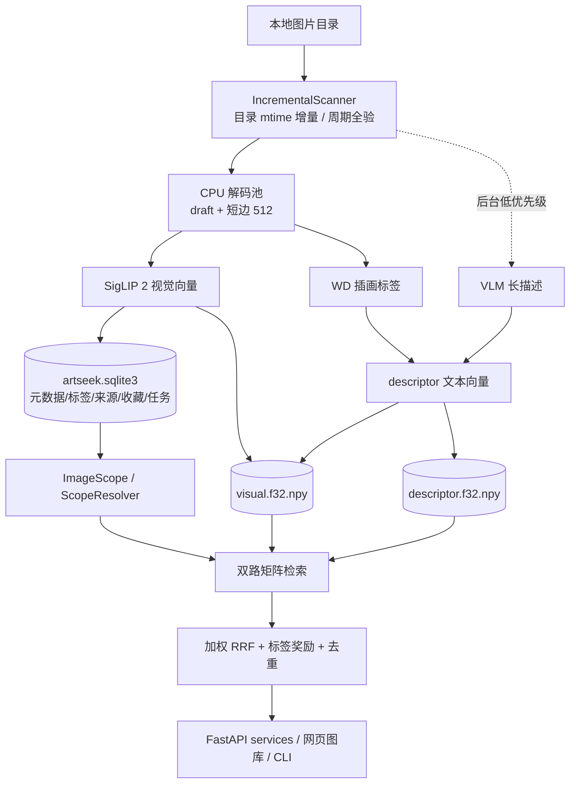

# ArtSeek 架构

## 设计动机

单一 CLIP 类向量常能找到“画面大致相似”的图片，但在插画收藏中会出现两个问题：

1. 服装部件、袜型、动作和镜头角度在整张图中占比很小，整体向量容易忽略；
2. 插画标签器能识别很多细节，却不理解“柔和、克制、电影感逆光氛围”这类自然语言。

因此 ArtSeek 不把所有信息压进一个通道，而是让整体视觉与细节描述分别召回，再进行结果级融合。v2 把运行时存储从 v1 的 Qdrant + 多个 sidecar 收敛为 **单个 SQLite 元数据库 + 两个 numpy 向量矩阵**。



## 数据模型

`{index_dir}/artseek.sqlite3`（WAL）是唯一的元数据真源，核心表：

| 表 | 内容 |
|---|---|
| `images` | 行号 = 向量矩阵行号，保留 v1 `point_id`；路径、mtime、尺寸、SHA-256、dHash、`sort_name` |
| `tags` / `image_tags` | WD 标签及分数 |
| `folders` / `roots` | 目录树、目录 mtime、选择与已知状态 |
| `collections` / `collection_items` / `collection_history` | 收藏与撤销/重做栈 |
| `artist*` / `image_source` / `source_tags` / `fetch_state` | 画师、身份、来源与抓取限速 |
| `notes_index` | 笔记文件索引；Markdown 文件仍是真源 |
| `query_plan_cache` | 查询规范化结果与 LLM 计划缓存 |
| `jobs` | 统一后台任务状态与进度 |
| `meta` | 模型名、维度、schema 版本、作用域偏好 |

`images.sort_name` 是索引时预计算的自然排序键（数字段补零、大小写折叠、段间控制符分隔），等价于 v1 `natural_key` 的二元组顺序。名称分页因此由 SQLite 在 C 层完成，不再把数万行取回 Python 排序。

向量只在 `.npy` 中，不写 SQLite blob：

- `visual.f32.npy`：SigLIP 图像向量；
- `descriptor.f32.npy`：WD 标签 + 可选长描述编码的文本向量；
- 形状 `(capacity, D)`，`fp32`，行号 = `images.id`；删除只置 `deleted=1` 并把对应行清零，`artseek compact` 重排；
- `VectorIndex` 内存检索；CUDA 可用时可镜像为 fp16 张量，CPU 侧始终保留 fp32。

点 ID 是规范化绝对路径的稳定 SHA-256 派生 UUID。重复扫描同一文件会覆盖旧行，而不是产生重复项。

## 增量索引

`IncrementalScanner` 对每个根目录：

1. 读取 `roots` / `folders` / `images` 快照；
2. 目录 mtime 未变化时走 delta，仅重扫变化的目录；
3. 超过 `[indexing] full_verification_interval_seconds` 或根标记为 dirty 时全量枚举，捕获“同尺寸 + 保留 mtime”的改写；
4. 比较 `path_key + mtime_ns + size_bytes + name`，只把新增/修改项送入流水线；
5. 已消失或换名的路径软删除并清零向量行；
6. 索引根不能相互嵌套，避免同一图片被多个根覆盖。

流水线（`ml/pipeline.py`）：

```text
8 线程读取字节 → SHA-256 + PIL draft + EXIF 转正 + 短边 512 缩小 + dHash
  → 有界队列 → 单 GPU 批次 (SigLIP encode_images + WDTagger predict)
  → descriptor 文本批编码 → 单事务写 SQLite → 写向量行
```

JPEG/WebP 在解码前使用 `Image.draft`，避免为 4K 图解码全分辨率；所有输入共用短边 512 的预缩放，查询图也走同一路径，保证索引/查询向量一致。SQLite 写入按批提交，向量按批刷盘；进程中断后根目录保持 dirty，下次全验恢复。索引、来源抓取、自动 Tag、长描述回填、compact 共用 `indexing/jobs.py` 的持久化优先队列，支持暂停/继续/停止。

## 查询解析

查询先经过静态插画词典，映射中文/日文服装与动作词到 WD 风格英语标签。若 Ollama 可用，再用结构化 JSON 输出补充：

- 中文语义改写；
- 英文视觉描述；
- 正向细节标签；
- 排除标签。

`SearchService` 先用离线计划立即返回结果；LLM 未命中缓存时不阻塞首屏，后台完成后写入 `query_plan_cache`，前端通过 `plan_revision` 获取精排结果。所有本地 Ollama 请求显式禁用 HTTP 代理。

## 范围与分页

所有列表接口只接收统一的 `ImageScope`：

```python
ImageScope(
    folders=(...), time_range=(...), collection_id=...,
    author_keys=(...), tags_all=(...), tags_none=(...),
    title_terms=(...), snapshot_ids=...
)
```

`ScopeResolver` 用单条 SQLite CTE 求交集并返回行号；搜索、目录、收藏、随机、tag、作者、画师瀑布流共用同一套分页：

- 非随机排序使用 `LIMIT/OFFSET` 或索引排序；
- 随机浏览使用 `seed + hash(seed, id)`，同一 seed 稳定分页；
- 名称排序走 `sort_name`，不取回全量行。

## 融合排序

文字查询分别进入 `visual` 与 `descriptor` 通道。图片查询只进入 `visual`；图片加文字则使用归一化的加权和作为组合查询向量。

两路候选使用加权倒数排名融合：

$$
S(i)=\sum_{c\in\{v,d\}}\frac{w_c}{60+r_c(i)}
+ \lambda\frac{|T_i\cap T_q^+|}{|T_q^+|}.
$$

其中：

- $r_c(i)$ 是图片 $i$ 在视觉或描述通道的排名；
- $w_c$ 是通道权重；
- $T_i$ 是图片标签；
- $T_q^+$ 是查询正标签；
- 负标签与图片标签相交时，图片直接排除。

倒数排名融合避免假设两个模型的余弦分数具有相同标定。界面显示的 0–100 分是当前结果相对第一名的归一化值。开启「去除重复」时，相同内容哈希或相同感知哈希的后续命中会被丢掉；没有哈希的旧记录仍按文件大小加宽高去重。

## 图片笔记

笔记库默认在 `{data_dir}/notes`，也可在高级设置中改到任意本地目录。缩略图在 `{cache_dir}/thumbnails`。每张图对应一个以内容哈希命名的文件夹，内含一篇或多篇 `.md` 以及可选的 `assets/`。字节级 `content_hash` 仍是文件夹名；打开笔记时再用 64 位差值哈希（dHash）在笔记库已登记的哈希上做 Hamming 近邻（默认距离 ≤ 10，并要求长宽比接近），把不同分辨率的同一画面别名到同一目录。近邻只扫笔记索引，不扫向量矩阵。过平的色块图不参与感知匹配，以免误并。删除一篇笔记时，只回收该篇引用、且位于该文件夹 `assets/` 下、并且不再被其他笔记引用的图片；删除整个文件夹才清空该图的全部笔记。网页查看器在原图旁打开浅色 Vditor；磁盘上的 Markdown 仍可被外部编辑器直接打开。

## 来源元信息

来源、画师、身份、合并历史与抓取状态都在 `artseek.sqlite3` 中；v1 的 `provenance.sqlite3`、`index_state.sqlite3`、`collections.json`、`folder_catalog.json` 只由 `artseek migrate-v1` 只读导入。文件名与嵌入 XMP/EXIF 的解析完全离线；网络补全按域名调度：Pixiv 默认单并发、0.75 秒/请求，FxTwitter 默认 4 并发、0.2 秒/请求；默认不设每日请求上限（`0` = 不限），`blocked_until` 仍持久化。搜索、目录、收藏、随机接口都接受 `author_key`，作者页 `/author/{key}` 直接展示该作者组的分页结果。索引完成后只对新点做本地扫描，并按 `[provenance] auto_enrich` 决定是否启动低速网络补全。详见 `docs/image-provenance.md`。

## 存储路径

「保存路径」只修改配置指向；「迁移」把当前索引库（SQLite + `.npy`）、笔记库或缓存复制到目标目录并切换。配置文件与 `runtime.json` 不随索引库迁移。切换索引库时服务重新打开数据库与向量矩阵，不清空来源/收藏数据。

## 可扩展点

- 将 `WDTagger` 替换为新的 PixAI/WD ONNX 标签器；
- 为人物姿态引入 2D keypoint/SMPL 专门向量；
- 把长描述拆成服装、动作、构图三个命名向量，支持独立权重；
- 大于数十万图片时，将 `VectorIndex` 后端替换为 faiss/HNSW，保持 `search(vector, channel, k, rows)` 接口不变；
- 增加文件系统监听器，将手动增量索引改为实时后台任务。
