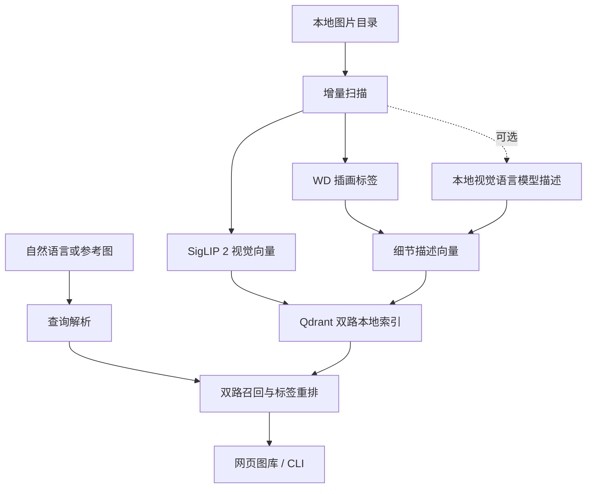

# ArtSeek 架构

## 设计动机

单一 CLIP 类向量常能找到“画面大致相似”的图片，但在插画收藏中会出现两个问题：

1. 服装部件、袜型、动作和镜头角度在整张图中占比很小，整体向量容易忽略；
2. 插画标签器能识别很多细节，却不理解“柔和、克制、电影感逆光氛围”这类自然语言。

因此 ArtSeek 不把所有信息压进一个通道，而是让整体视觉与细节描述分别召回，再进行结果级融合。



## 数据模型

每个 Qdrant 点包含两个同维向量：

- `visual`：直接从图片编码，支持文字到图片、图片到图片；
- `descriptor`：把 WD 标签和可选长描述编码成文本向量。

Payload 保存：

- 原图绝对路径、规范化路径、根目录；
- 文件大小、纳秒修改时间、宽高、扩展名；
- 文件内容 SHA-256 与 64 位感知哈希（dHash）；
- 插画标签、标签分数；
- 可选结构化图片描述及其扁平文本。

点 ID 是规范化绝对路径的稳定 SHA-256 派生 UUID。重复扫描同一文件会覆盖旧向量，而不是产生重复项。

## 增量索引

对每个根目录，索引器先读取已有 payload，再比较：

```text
path_key + mtime_ns + size_bytes
```

三项相同则跳过。目录中已消失的路径会从向量库移除。该操作不会删除、重命名或写入原图。

使用 `--force` 会忽略增量判断，适合首次开启长描述或调整标签阈值；更换向量模型则必须 `rebuild`。

## 查询解析

查询先经过静态插画词典，映射中文/日文服装与动作词到 WD 风格英语标签。若 Ollama 可用，再用结构化 JSON 输出补充：

- 中文语义改写；
- 英文视觉描述；
- 正向细节标签；
- 排除标签。

解析器被要求只改写用户的可见条件，不添加主体、角色、画师或故事。

## 融合排序

文字查询分别进入 `visual` 与 `descriptor` 通道。图片查询只进入 `visual`；图片加文字则使用归一化的加权和作为组合查询向量。

两路候选使用加权倒数排名融合：

$$
S(i)=\sum_{c\in\{v,d\}}\frac{w_c}{60+r_c(i)}
+ \lambda\frac{|T_i\cap T_q^+|}{|T_q^+|}.
$$

其中：

- $r_c(i)$ 是图片 $i$ 在视觉或描述通道的排名；
- $w_c$ 是通道权重；
- $T_i$ 是图片标签；
- $T_q^+$ 是查询正标签；
- 负标签与图片标签相交时，图片直接排除。

倒数排名融合避免假设两个模型的余弦分数具有相同标定。界面显示的 0–100 分是当前结果相对第一名的归一化值。开启「去除重复」时，相同内容哈希或相同感知哈希的后续命中会被丢掉；没有哈希的旧 payload 仍按文件大小加宽高去重。

## 图片笔记

笔记库默认在 `{data_dir}/notes`，也可在高级设置中改到任意本地目录。缩略图在 `{cache_dir}/thumbnails`。索引数据库默认与 `data_dir` 相同，含 `index_state.sqlite3`、`folder_catalog.json`、`folder_scope.json`、`collections.json` 与 `manifest.json`。「保存路径」只改指向；「迁移」把当前向量库、笔记库、缓存或索引 sidecar 复制到目标目录并切换过去，源目录保留。配置文件与 `runtime.json` 不随索引库迁移。每张图对应一个以内容哈希命名的文件夹，内含一篇或多篇 `.md` 以及可选的 `assets/`。字节级 `content_hash` 仍是文件夹名；打开笔记时再用 64 位差值哈希（dHash）在笔记库已登记的哈希上做 Hamming 近邻（默认距离 ≤ 10，并要求长宽比接近），把不同分辨率的同一画面别名到同一目录。近邻只扫笔记库索引，不扫 Qdrant。过平的色块图不参与感知匹配，以免误并。Qdrant 点 ID 仍做反向索引，原图删除后文件夹还在。删掉一篇笔记时，只回收该篇引用、且位于该文件夹 `assets/` 下、并且不再被其他笔记引用的图片；删除整个文件夹才清空该图的全部笔记。网页查看器在原图旁打开浅色 Vditor；磁盘上的 Markdown 仍可被外部编辑器直接打开。界面用 History API 给搜索、目录、收藏夹、随机浏览、原图和笔记各自一条可复制的 URL（`/search?q=&ref=&s=`、`/folder?key=`、`/c/{id}`、`/random?seed=`、`/i/{point_id}`、`/i/{point_id}/notes/{name}`），刷新和浏览器后退/前进会还原对应视图。搜索链接保存查询文本、库内参考图 ID（及可选权重）和 12 位快照编号；完整结果写在 `{cache_dir}/search-snapshots/`，不把 768 维向量塞进 URL。打开链接时先读快照，没有再按文本和库内参考图重搜。粘贴的本地参考图不能写进链接，但快照仍能还原当时的结果页。笔记正文里的同站链接会在应用内跳转，因此可以把地址栏 URL 贴进另一篇笔记作为引用。原图文件仍由 `/image/{point_id}` 提供，与 SPA 路径分开。多篇笔记的顺序写在该文件夹的 `.artseek.json` 的 `note_order` 里，与文件名解耦；未记录顺序的旧目录仍按文件名排列。显示标题取自正文第一个非空行（ATX 标题标记会剥掉）；磁盘文件名是 UTC 时间戳，冲突时加后缀，避免「笔记」「未命名」这类占位名。旧的以标题命名的文件仍可打开。

## 来源元信息

`{index_dir}/provenance.sqlite3` 保存每张图的 Pixiv 作品或 X/Twitter 推文来源、作者组、抓取状态与限速预算。文件名与嵌入 XMP/EXIF 的解析完全离线；网络补全按域名调度：Pixiv 默认单并发、0.75 秒/请求，FxTwitter 默认 4 并发、0.2 秒/请求；默认不设每日请求上限（`0` = 不限），`blocked_until` 仍持久化。SauceNAO/ascii2d 不配置 API key，查看器只提供打开页面和 URL 粘贴。搜索、目录、收藏、随机接口都接受 `author_key`，作者页 `/author/{key}` 直接展示该作者组的分页结果。索引完成后只对新点做本地扫描，并按 `[provenance] auto_enrich` 决定是否启动低速网络补全。详见 `docs/image-provenance.md`。

## 可扩展点

- 将 `WDTagger` 替换为新的 PixAI/WD ONNX 标签器；
- 为人物姿态引入 2D keypoint/SMPL 专门向量；
- 把长描述拆成服装、动作、构图三个命名向量，支持独立权重；
- 大于数十万图片时，将 `VectorStore` 从 Qdrant 本地模式切换到本机 Qdrant Server；
- 增加文件系统监听器，将手动增量索引改为后台任务。

