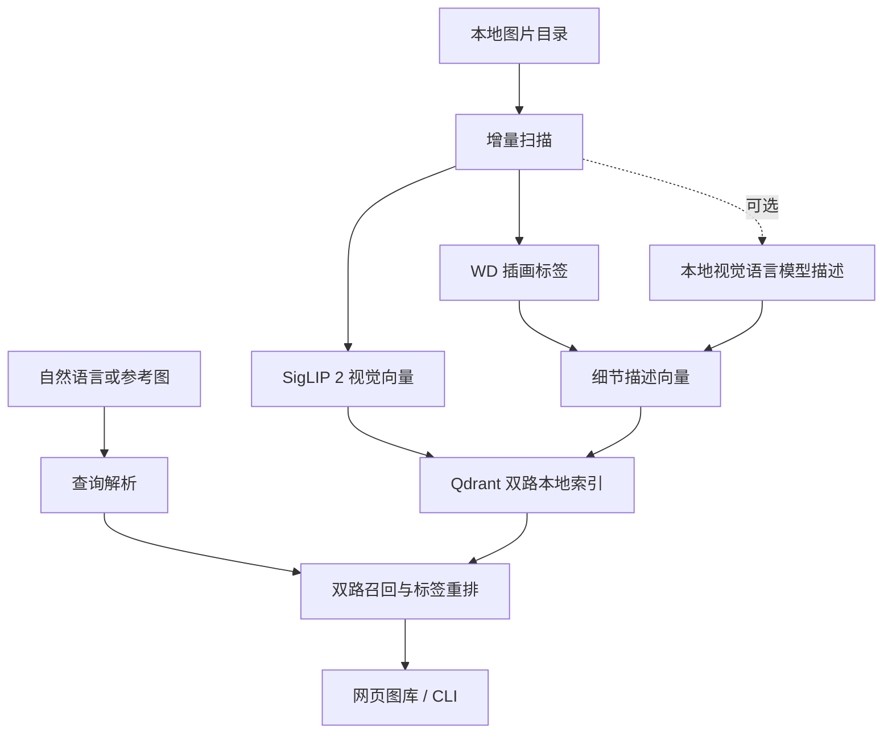

# ArtSeek 架构

## 设计动机

单一 CLIP 类向量常能找到“画面大致相似”的图片，但在插画收藏中会出现两个问题：

1. 服装部件、袜型、动作和镜头角度在整张图中占比很小，整体向量容易忽略；
2. 插画标签器能识别很多细节，却不理解“柔和、克制、电影感逆光氛围”这类自然语言。

因此 ArtSeek 不把所有信息压进一个通道，而是让整体视觉与细节描述分别召回，再进行结果级融合。



## 数据模型

每个 Qdrant 点包含两个同维向量：

- `visual`：直接从图片编码，支持文字到图片、图片到图片；
- `descriptor`：把 WD 标签和可选长描述编码成文本向量。

Payload 保存：

- 原图绝对路径、规范化路径、根目录；
- 文件大小、纳秒修改时间、宽高、扩展名；
- 插画标签、标签分数；
- 可选结构化图片描述及其扁平文本。

点 ID 是规范化绝对路径的稳定 SHA-256 派生 UUID。重复扫描同一文件会覆盖旧向量，而不是产生重复项。

## 增量索引

对每个根目录，索引器先读取已有 payload，再比较：

```text
path_key + mtime_ns + size_bytes
```

三项相同则跳过。目录中已消失的路径会从向量库移除。该操作不会删除、重命名或写入原图。

使用 `--force` 会忽略增量判断，适合首次开启长描述或调整标签阈值；更换向量模型则必须 `rebuild`。

## 查询解析

查询先经过静态插画词典，映射中文/日文服装与动作词到 WD 风格英语标签。若 Ollama 可用，再用结构化 JSON 输出补充：

- 中文语义改写；
- 英文视觉描述；
- 正向细节标签；
- 排除标签。

解析器被要求只改写用户的可见条件，不添加主体、角色、画师或故事。

## 融合排序

文字查询分别进入 `visual` 与 `descriptor` 通道。图片查询只进入 `visual`；图片加文字则使用归一化的加权和作为组合查询向量。

两路候选使用加权倒数排名融合：

\[
S(i)=\sum_{c\in\{v,d\}}\frac{w_c}{60+r_c(i)}
+ \lambda\frac{|T_i\cap T_q^+|}{|T_q^+|}.
\]

其中：

- \(r_c(i)\) 是图片 \(i\) 在视觉或描述通道的排名；
- \(w_c\) 是通道权重；
- \(T_i\) 是图片标签；
- \(T_q^+\) 是查询正标签；
- 负标签与图片标签相交时，图片直接排除。

倒数排名融合避免假设两个模型的余弦分数具有相同标定。界面显示的 0–100 分是当前结果相对第一名的归一化值。

## 可扩展点

- 将 `WDTagger` 替换为新的 PixAI/WD ONNX 标签器；
- 为人物姿态引入 2D keypoint/SMPL 专门向量；
- 把长描述拆成服装、动作、构图三个命名向量，支持独立权重；
- 大于数十万图片时，将 `VectorStore` 从 Qdrant 本地模式切换到本机 Qdrant Server；
- 增加文件系统监听器，将手动增量索引改为后台任务。

