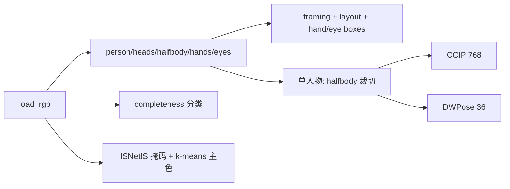

# 参考检索增强（refine）

本文档定义 ArtSeek 的第二类索引：**把图当成"某个角色的某张参考图"来组织**。它建立在 deepghs/imgutils 提供的动漫专用小模型之上，与现有 `SigLIP 2` + `WD EVA02` 双通道检索**正交**，回答的是"这是谁 / 这组图是否一套 / 这张图的构图与取景是什么"这类问题，而不是"画的是什么"。

范围（已确认）：角色相册、差分折叠、检测框与取景分层、构图检索、姿势检索与骨架叠加、手部/眼睛参考、配色板、角色页二级分组，以及附带的抠图与线稿能力。明确不做：参考板拼图导出、增强预览（超分/去伪影）、差分表导出、OCR。

## 设计决策

### 1. 侧车索引，不动主集合

主集合 `artseek_images` 的两个命名向量与图文模型的维度绑定；在其中新增第三种向量意味着**全量重建**（等于把所有图重新过一遍 SigLIP 2）。而 refine 的特征彼此独立、可单独丢弃、阈值需要反复调。

因此 refine 的所有派生数据放在**侧车**中，与现有 `index_state.sqlite3` / `provenance.sqlite3` / `folder_catalog.json` 同级：

| 存储 | 内容 | 可丢弃性 |
|---|---|---|
| Qdrant `artseek_refine` | `character` 768 维（COSINE）、`pose` 36 维、`layout` 12 维、`palette` 15 维，后三者 EUCLIDEAN | 可整体删除 |
| `{index_dir}/refine.sqlite3` | 每点的标量特征、聚类归属、簇命名、手工拆组覆盖 | 可整体删除 |
| `{cache_dir}/refine/` | 手/眼/脸裁切与抠图缓存 | 可整体删除 |

实测（qdrant-client 本地模式）确认两件事：同一集合允许不同维度的命名向量共存；点数可以只提供部分命名向量，按缺失向量检索时这些点被自然跳过。因此单集合即可承载全部特征，无需按"是否有人物"拆库；多人图只写 `layout`/`palette`，不写 `character`/`pose`，查询语义正好是"只有可比的图参与"。`feature_version` 变更时整库删除重建，因为它是纯派生数据。侧车集合与主集合共享 `point_id` 与 `content_hash`，任意一侧被删除都只影响对应功能，`artseek index` 不感知 refine。

### 2. 特征向量只是候选生成器，判定一律用原模型

CCIP 的差异值**不是**特征向量之间的余弦距离：

$$
d_{\text{ccip}}(f_i,f_j)=\text{MetricHead}(f_i,f_j),\qquad \text{same} \iff d \le \tau
$$

默认模型 `ccip-caformer-24-randaug-pruned` 的 $\tau = 0.1785$（来自模型仓库 `metrics.json`），而 `ccip_batch_differences` 直接接受 768 维特征、不需要再解码图片，单次批量调用很便宜。

所以统一采用 **ANN 候选 → 原模型复核** 的两段式：

1. Qdrant 按特征向量取近邻（`character` 用 COSINE、`pose`/`layout`/`palette` 用 EUCLIDEAN），每点只取 $k$ 个候选；
2. 候选对再用 `ccip_batch_differences` / `lpips_difference` / 掩码关键点距离 / CIE76 色差复核；
3. 通过复核的对进入并查集聚类。

这个结构同时避免了 $O(N^2)$ 的两两比较：总代价是 $O(Nk)$，$k$ 默认 24（角色）、12（差分），可配置。

### 3. 新通道不参与主评分融合

现有倒数排名融合假设两路余弦分数可以按排名定标。把几何/身份通道混进同一个 $S(i)$ 会破坏这一假设，且这些信号只在"专门找参考"时才有意义。

因此 refine 通道是**独立的浏览模式与筛选条件**（`/character/{id}`、`同构图`、`同配色`、`取景` 下拉），不做并集融合。将来若要融合，必须先有离线评估集，不在本计划内。

## 特征定义

所有几何量归一化到 $[0,1]$（除以图片宽高），与分辨率无关。

- `framing`：由人物框高度 $h_p/H$、头框高度 $h_h/H$、人物数 $n$ 判定 `closeup / half / full / multi / none`。阈值进配置，默认 `closeup: h_p/H < 0.55`、`full: h_p/H > 0.85`。
- `layout`（12 维）：主人物框中心 $(cx,cy)$、宽高占比、头框中心 $(cx,cy)$、头框宽占比、头顶留白、画幅比、人物数、头框高/人物框高（视距线索）、脚底留白。
- `character`（768 维）：单人物图按 人物框 → `detect_halfbody` 裁上半身 → 缩放到 384 方图 → `ccip_extract_feature`。多人图与无人图不写该点。
- `pose`（36 维）：`dwpose_estimate` 是自顶向下的 RTMPose（输入 288×384，依赖人物框），返回 `OP18KeyPointSet`：`.body` 为 $18\times3$ 的 $(x,y,\text{score})$ 像素坐标，`.all` 为 134 点（身体 18 + 面部 68 + 双手 42 + 双脚 6）。取 body 的 $(x,y)$ 除以人物框尺寸归一化，score 为 0 的点视为缺失并在 SQLite 中保留掩码，复核时按掩码计算均方距离。
- `palette`（15 维）：有人物时在 ISNetIS 掩码内取色，否则全图取色，$k=5$ 的 k-means 主色，sRGB 归一化；同时把十六进制列表写进 payload 供界面显示。RGB 欧氏距离只用于候选，复核用 CIE76 $\Delta E$。
- 标量：`person_count`、`hand_boxes`、`eye_count`、`completeness`（`polished / rough / monochrome`）及其分数、`flags`（`multi_character`、`no_person`、`person_cropped`）。

## 抽取流水线

单图一次解码，复用 `image_io.load_rgb`，全部检测共享同一张 PIL 图像：



- 只有当 `[refine] enabled = true` 时才会执行；失败按图记录到 `flags`，不影响主索引写入。
- 增量键与主索引一致（`path_key + mtime_ns + size_bytes`），再加 `feature_version`：升级模型或改阈值只重算受影响的部分。
- 性能预算（本机 CPU 实测，onnxruntime 1.32 仅 CPU EP，单张 1024×1024 预热后）：CCIP 2.2 s、头部 0.76 s、人物 1.16 s、手部 0.70 s、眼睛 0.78 s、DWPose 3.5 s、ISNetIS 2.7 s、完成度分类 0.27 s。全开约 12 s/图，1 万张即 30 余小时。因此：默认关闭；按特征分批（`--only character,layout`）；无 GPU 时只建议开角色与构图，手/眼/姿态/抠图按需。模型磁盘开销已实测约 390 MB（CCIP 144 MB + 人物 99 MB + 三个检测器各 43 MB + 完成度 17 MB），另加姿态与分割模型。onnxruntime 默认只有 CPU provider，GPU 需要 `dghs-imgutils[gpu]`（onnxruntime-gpu）。检测器接受 `ImageTyping`，可先缩到长边 1024 再送检测以压低开销。

## 聚类

- **角色簇**：以 `character` ANN 邻居为候选，`ccip_batch_differences ≤ τ` 的边进入并查集。簇名取成员 WD 角色标签的加权投票最高者；无角色标签时命名 `未命名角色 {id}`，界面可改名（写入 `refine_cluster.manual_name`）。
- **差分组**：候选来自 `phash` 近似（Hamming ≤ 10）与 `visual` 前 $k$ 邻居，`lpips_difference ≤ 0.45` 为边。已在同一 `character` 簇内且 LPIPS 超阈的对，视为"同角色不同作品"，不合并。界面默认折叠为一张卡片（角标 `+N`），支持手动拆组，覆盖写入侧车。
- 聚类是全局派生状态：新增图像后按需重算，或 `artseek refine --recluster`。单个簇的成员数上限用于防止"一个簇吞掉半个库"，超限时按阈值收紧重跑该簇。
- **角色页二级分组**：簇内按 descriptor 标签差集聚类成"服装分支"（常服/礼服/外套），纯统计，无新模型。

## 阈值标定（发布门槛）

模型自带的 $\tau$ 来自公开数据，未必匹配你的库。上线角色相册前必须运行：

```
artseek refine --calibrate --sample 400
```

它抽取带 WD 角色标签的图，统计同角色对/不同角色对的 $d_{\text{ccip}}$ 分布，输出阈值-准确率曲线与 ARI，写入 `config.toml` 的 `ccip_threshold`。**未标定（`ccip_threshold = 0`）时角色聚类界面隐藏**，`/character/` 路由返回 404，避免给出不可信的分组。

## 配置

```toml
[refine]
enabled = false              # 默认关闭：额外模型与磁盘开销
device = "auto"
batch_size = 8
feature_version = 1          # 改动模型或特征定义时自增，触发定向重算

ccip_model = "ccip-caformer-24-randaug-pruned"
ccip_threshold = 0.0         # 由 --calibrate 写入；0 = 未标定
ccip_neighbors = 24

lpips_threshold = 0.45
lpips_neighbors = 12

pose_enabled = true
palette_colors = 5
halfbody_min_conf = 0.5
```

`artseek doctor` 增加 refine 段：依赖是否可用、各模型是否已缓存、侧车覆盖率、是否已标定。`artseek pull-models --with-refine` 预取模型到本地缓存，保持"索引后可离线"。

## CLI 与接口

```
artseek refine DIR...            # 增量抽取
artseek refine DIR... --recluster
artseek refine --calibrate --sample 400
artseek refine --status
```

- `GET /character/{cluster_id}`：角色相册页（与 `/author/{key}` 结构对称）。
- `GET /api/character/{cluster_id}`、`GET /api/character/similar?point_id=&limit=`。
- `GET /api/variants/{cluster_id}`；gallery 卡片通过 payload 注入的 `variant_id` 折叠。
- `GET /api/layout/similar?point_id=`、`GET /api/palette/similar?point_id=`、`GET /api/palette/similar?colors=%23f2d5d5,...`
- `GET /api/refine/crop?point_id=&kind=hand|eye|face&index=0`：从原图裁切并缓存，不写原图。
- `GET /api/pose/skeleton?point_id=`：返回 18 点与原图尺寸，前端 canvas 叠加，不做图像合成。
- 现有 gallery 接口新增筛选参数：`framing`、`completeness`、`persons`、`min_person_ratio`、`has_hands`。筛选只读侧车，不改主集合。

## 依赖与许可

`dghs-imgutils` 当前版本 `0.19.0`，实测在本项目虚拟环境中会带来：

- **numpy 2.4.6 → 1.26.4**（包内声明 `numpy<2`，与本项目 `numpy>=1.26,<3` 兼容，但属强制降级）；
- 新增约 25 个包，含 `opencv-contrib-python`、`pandas`、`scipy`、`scikit-learn`、`shapely`、`pilmoji`、`hbutils`、`hfutils`、`wcmatch` 等，另需 `onnxruntime`。

因此：

1. 作为可选 extra `refine`，不进入 `all`，`pyproject.toml` 显式加 `numpy<2` 说明；
2. 安装后必须跑完整 pytest 与一次真实索引，确认 numpy 降级无回归；
3. 若回归或体积不可接受，退化为"仅依赖 `onnxruntime` + 自实现 CCIP/YOLO/ISNetIS 预处理"，姿态部分暂缓——模型本身都是 ONNX，托管在 `deepghs/*` 仓库；
4. 逐个核对模型许可后再写入 `README.md` 的模型表（CCIP 来自 `7eu7d7`，ISNetIS 来自 `skytnt/anime-seg`，DWPose 与 deepghs YOLO 各有来源），未核对前不公开宣称可商用。

## 里程碑

1. **M0 依赖探针（spike）**：装上 imgutils，对 20 张样本跑通 CCIP/检测/DWPose/ISNetIS，记录维度、耗时、显存；numpy 降级后全量 pytest 通过；输出许可清单。验收：一页测量记录 + 许可表。
2. **M1 抽取与侧车**：`refine` 包、`refine.sqlite3`、两个 Qdrant 侧车集合、`artseek refine` 增量、`doctor` 探测。验收：重复运行不重算、删侧车可重建、纯逻辑单测（归一化、掩码距离、并查集）通过。
3. **M2 标定**：`--calibrate` 报告阈值曲线与 ARI，写入配置并按标定状态控制界面可见性。验收：在真实库上给出阈值与准确率数字。
4. **M3 角色相册 + 差分组**：聚类引擎、角色页、`同角色`、折叠卡片、手动拆组、簇改名、角色页二级分组。验收：抽样 20 组人工复核，误并 ≤ 1 组。
5. **M4 浏览层**：取景/完成度筛选、`同构图`、手/眼参考页、骨架叠加、配色板与`同配色`。验收：每个入口在真实库有结果且分页正常。
6. **M5 收尾**：README、ARCHITECTURE、`pull-models --with-refine`、性能记录（单图耗时、侧车体积）、完整测试与浏览器手检。

## 风险

| 风险 | 处理 |
|---|---|
| numpy 强制降级引起隐性问题 | M0 全量 pytest + 真实索引；失败即切自实现路线 |
| 依赖体积与 Windows 安装复杂度 | 独立 extra；`doctor` 明确报告缺哪一项 |
| CCIP 只适用单角色，多人图会污染簇 | 多人图不写 `character`/`pose` 向量；`flags` 记录，界面提示 |
| 阈值跨库不可复用 | M2 标定为网关，未标定即隐藏功能 |
| 差分组把同系列不同构图并在一起 | 人工复核 + 手动拆组持久化 |
| 手/眼/骨架在遮挡与夸张透视下不稳 | 仅作提示与候选，不做硬过滤 |
| 肤色/RGB 距离与人眼不一致 | 候选用 RGB，复核用 CIE76 |
| refine 增加索引时长 | 默认关闭；支持按特征分批；不计入主索引成功与否 |
